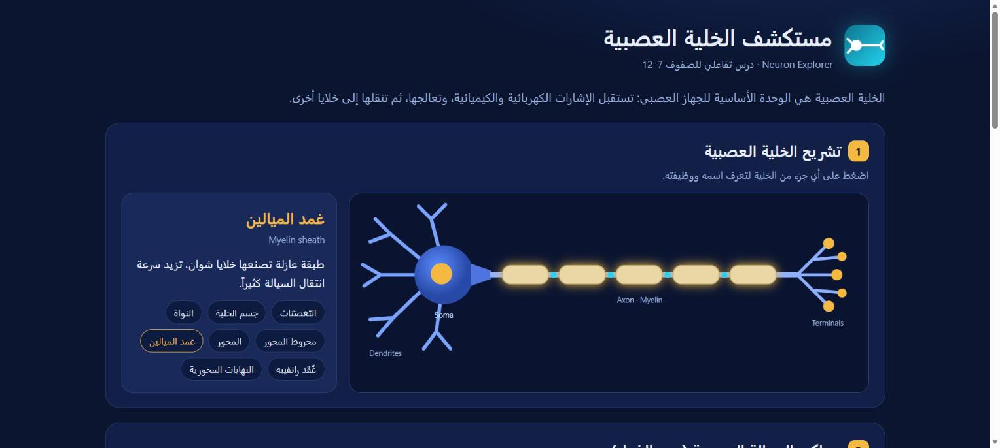
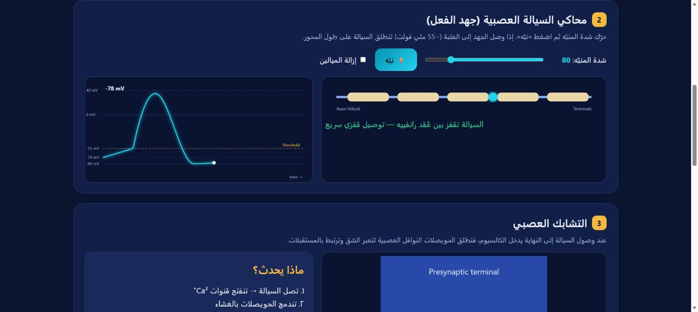
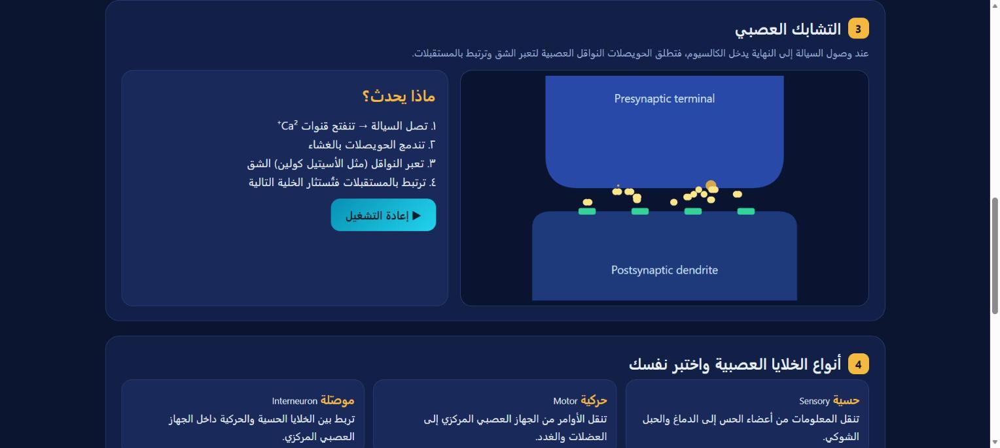

# neuron-explorer

مهارة (Skill) تحوّل أي سؤال عن الخلية العصبية إلى **درس HTML تفاعلي بالعربية**: تشريح قابل للنقر، محاكي للسيالة العصبية (جهد الفعل) بمنبّه وعتبة، رسم متحرك للتشابك العصبي، أنواع الخلايا العصبية، واختبار من 5 أسئلة.

An agent skill that turns any neuron question into a single-file, interactive Arabic/English HTML lesson: clickable neuron anatomy, an action-potential simulator with stimulus slider and threshold (with and without myelin), an animated synapse, neuron types and a 5-question quiz.

## أمثلة من المخرجات | Examples

| | | |
|---|---|---|
|  تشريح تفاعلي · Anatomy |  محاكي السيالة · Action potential |  التشابك والاختبار · Synapse & quiz |

جرّب الناتج مباشرة: [`examples/neuron-explorer.html`](examples/neuron-explorer.html) (نزّله وافتحه في المتصفح).

## طريقة الاستخدام | Usage
- `اشرح لي الخلية العصبية بشكل تفاعلي`
- `Use $neuron-explorer to build an interactive Arabic lesson on neurons for grade 9.`

## Structure
- `SKILL.md` — main instructions
- `agents/openai.yaml` — display metadata
- `assets/icon.svg`
- `examples/` — sample output page and screenshots

## Install
**ChatGPT:** download the repo as ZIP → Skills → Create → Upload from your computer.
**Claude / Codex:** copy the `neuron-explorer` folder into your skills directory (e.g. `~/.claude/skills/`).

By [AIOMAN](https://github.com/AIOMAN-OM)

## License

MIT — see [LICENSE](LICENSE).
